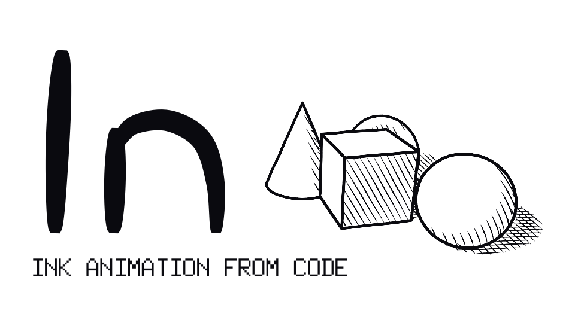
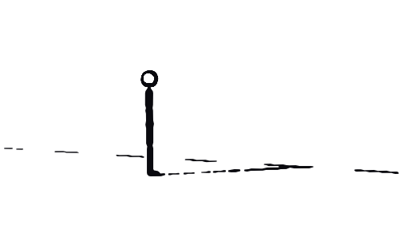
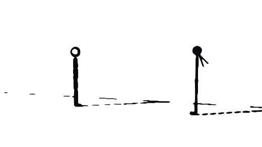
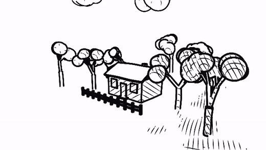
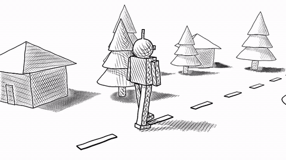
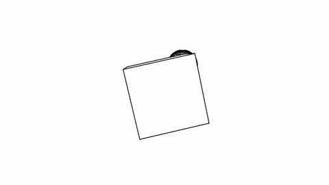
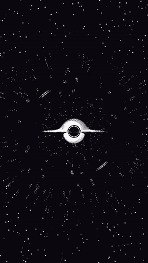

<p align="center">
  
</p>

<h1 align="center">ln</h1>

<p align="center"><b>Draw and animate with code. Get hand-inked pictures, GIFs and video.</b></p>

<p align="center">
  
  
  
  
  
  
</p>

<p align="center">
  
</p>
<p align="center"><sub>One stick man, every move, drawn by <code>go run ./examples/engine/stickman</code>. No frames were drawn by hand.</sub></p>

<table align="center">
  <tr>
    <td align="center" width="50%"><br><b>Stick fight</b><br><sub>Two fighters, a dozen moves, comic effects, a follow camera.<br><code>examples/engine/stickfight</code></sub></td>
    <td align="center" width="50%"><br><b>Village</b><br><sub>Swaying trees, a sun crossing the sky, cast shadows, a camera glide.<br><code>examples/ink/village</code></sub></td>
  </tr>
  <tr>
    <td align="center" width="50%"><br><b>Walker</b><br><sub>A jointed robot, a camera that follows and circles it, a moving sun.<br><code>examples/engine/walker</code></sub></td>
    <td align="center" width="50%"><br><b>Spin</b><br><sub>The pen draws the scene in, a cube turns, a sphere orbits, the camera follows a spline.<br><code>examples/animation/spin</code></sub></td>
  </tr>
  <tr>
    <td align="center" colspan="2"><br><b>Black hole</b><br><sub>Light bent by gravity (<code>ln/physics</code>), drawn as ink lines. Zooms in, rises above the disk, skims it, pulls back.<br><code>examples/space/blackhole</code></sub></td>
  </tr>
</table>

<p align="center"><sub>More examples. Every frame here is drawn by code, and nothing was animated by hand.</sub></p>

---

`ln` is a Go engine that turns a few lines of code into pen-and-ink art. You describe shapes, a camera, a light and some motion. It ray-casts the scene, works out where the shadows fall, and draws it as clean ink lines, hatching and solid blacks, with hand-drawn wobble. The output is a still, an SVG, a GIF or a video.

It began as a fork of [fogleman/ln](https://github.com/fogleman/ln), a 3D line renderer for pen plotters. The renderer core is from there. Everything above it is new.

## What you can make

| | |
|---|---|
| **Any shape, from code** | Boxes, spheres, tori, cones and capsules. Spin a curve into a vase (`Lathe`), lift an outline into a solid (`Extrude`), sweep a pipe along a path (`Tube`), or turn any formula `f(u,v)` into a surface. Every shape gets smooth shading and clean outlines automatically. |
| **Worlds** | Terrain from a height function, forests scattered over it, mirror lakes with rippled reflections, and a sky model with a sun, moon and stars that moves through sunrise, noon, dusk and night with correct cast shadows. Any object can be a lamp. |
| **Characters and motion** | Skeletons described as data. Moves written as keyframe tables or oscillators, then blended, jumped, flipped and spun with one-line modifiers. A complete stick man with 25 moves ships in the box. |
| **Comic effects** | Dust puffs, impact stars, speed lines, smear arcs, screen shake and a follow camera, all triggered by named marks on a move. |
| **Five looks** | Hatched `ink`, clean `manga` with solid blacks, loose `sketch`, precise `technical`, and `ascii`. Switch with one flag. The scene never changes. |
| **Any output** | PNG, SVG, MP4, WebM and GIF. Video needs `ffmpeg`. |

## A scene in a few lines

```go
package main

import . "github.com/loyality7/ln/components/studio"

func main() {
	Run(func(s *Scene) {
		s.Look("manga")                          // ink | manga | sketch | technical | ascii
		s.TimeOf("dusk")                         // dawn ... noon ... dusk ... night
		s.Camera(V(0, -12, 3), V(0, 0, 1), 40)   // where it stands, what it looks at, field of view

		s.Root.Box(10, 10, 0.2).At(0, 0, -0.1)   // a floor
		ball := s.Root.Sphere(1).At(-3, 0, 1)
		s.TL.Move(ball, V(3, 0, 1), 2, anim.OutBounce) // roll it across in 2 seconds
	})
}
```

```
go run .                  # a video, because the scene has motion
go run . -still 1         # one picture, at second 1
go run . -look ascii -sky night -fmt gif -out out/ball
```

The one-page [cheat sheet](docs/cheatsheet.md) covers everything you need to write a scene.

## Characters in a few lines

A move is a table of poses. There is no motion code.

```go
punch := rig.Keys(0.9,
	rig.K(0,    pose{"shoulderN": 72, "elbowN": 112}),   // guard
	rig.K(0.3,  pose{"shoulderN": -28, "elbowN": 130}),  // wind up
	rig.K(0.46, pose{"shoulderN": 90, "elbowN": 6})).    // strike
	Travel(0.35, 0, 0.5).                                // lunge forward
	Mark(rig.Mark{Kind: "impact", At: 0.5, X: 1.17, Z: 1.28}) // comic star where it lands

hero.Play(walk)
hero.Play(punch)                                          // blended, one after another
rig.Beat(s.TL, rig.Moves(a, punch), rig.Moves(b, block))  // two actors at once
fx.Install(s.Stage, fx.DefaultFollow(), a, b)             // dust, stars, shake, camera
```

The stick man above and the two-man fight in the grid are scripts of this kind: blocks, dodges, an uppercut, a flying kick, a spin kick, a double flip, a clash and a knockout, about 60 lines of choreography.

## How it works

```
 scene graph         shapes + lights          per-pixel buffers          a look            picture
 (nodes, timeline) -> (meshes, mirrors, sun) -> (depth, normal, object) -> (ink / manga /   -> PNG SVG
  rigs, clips                                    shadow, reflection        ASCII ...)          GIF MP4
```

Every arrow is an interface. A new look, a new light or a new kind of shape plugs in without touching the rest. The ink looks read the same per-pixel buffers, so any shape works with every look, reflections and shadows included.

## Project layout

`ln/` is the core: machinery that makes and draws shapes, with no specific objects in it.

| Package | Job |
|---|---|
| `ln/geom` `ln/shapes` `ln/accel` `ln/model` `ln/scene` | Math, ray-cast shapes (with mirrors), BVH, meshes, scene |
| `ln/solid` | The shape forge: lathe, extrude, tube, any `f(u,v)` surface, smooth shading, outlines |
| `ln/light` `ln/buffer` | Lights behind one interface, and the visible world sampled per pixel |
| `ln/ink` `ln/ascii` | The looks: hatched ink, manga, ASCII |
| `ln/stage` `ln/anim` | Scene graph, timeline in seconds, easing, video and GIF export |
| `ln/rig` `ln/fx` | Characters and motion as data; comic effects and the follow camera |
| `ln/physics` | General laws: RK4 integrators, gravity and orbits, light bending, Doppler and beaming, thermal radiation |
| `components/` | Things built on the core: `studio` (the simple front door: one import, no boilerplate), `env` (sky, sun, moon), `nature` (terrain, pines, rocks), `stickman`, `mannequin`, `world`, `blackhole` |

Nothing in `ln/` knows about any specific object. You can write your own components the same way.

## Run the examples

The gallery at the top is built from these:

```
go run ./examples/engine/stickman      # every stick man move, with captions
go run ./examples/engine/stickfight    # two stick men fight
go run ./examples/ink/village          # the village
go run ./examples/engine/walker        # the walking robot
go run ./examples/animation/spin       # the spinning cube
go run ./examples/scenes/lake          # a mirror lake with a figure on the shore
go run ./examples/engine/daycycle      # one scene across a whole day
go run ./examples/forge/shapes         # every shape-forge function in one picture
go run ./examples/logo                 # draws the logo above with the engine itself
```

Needs Go and, for video, `ffmpeg` on your PATH. Output goes to `out/`.

## Status

| | |
|---|---|
| **Solid** | The shape forge, lights and shadows, mirrors, the sky model, the ink and ASCII looks, the rig and clip system, the stick figure and its effects. All have tests. |
| **Experimental** | The `manga` look (clean at a distance, rough on close-ups) and `components/mannequin`. |
| **Not built yet** | Colour, boolean cuts on meshes, a scripting layer so scenes can be written without Go, scene files. |

Full API: [docs/engine.md](docs/engine.md).

## Credits

Started from [fogleman/ln](https://github.com/fogleman/ln) by Michael Fogleman (MIT). MIT licensed, see [LICENSE.md](LICENSE.md).
